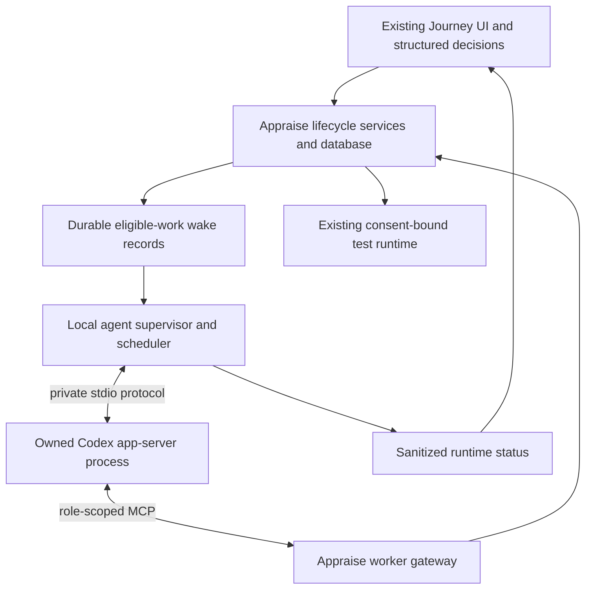

# Codex app-server behind AppraiseJS: Journey migration proposal

Date: 2026-10-12. Status: reviewed planning proposal; implementation and runtime qualification not started.

## Scope and authority

Keep users in AppraiseJS for briefs, questions, reviews, consent, progress, recovery and results. Run Codex as a supervised local backend using MCP. There is no chat composer, transcript product, manual prompt handoff, or requirement to open Codex desktop in the normal flow. Native provider sign-in and target-site login may still require a browser; no-chat does not mean unattended authentication.

This document and [task list](todo.md) are a proposed migration, not a replacement of accepted ADR-0004 or permission to run live Journeys. Existing `tasks/plan.md` and `tasks/todo.md` cover unrelated work and are preserved. The current coordinator [register](../../codex/development%20plan/appraise-0.5/product%20direction/managed-quality-journey-coordinator/TASK_REGISTER.md) remains authoritative for its existing track. As inspected, GC2 passed; C3.3 remains in progress and GC3 is REVISE/not passed. The 2026-10-12 entry leaves section 3 incomplete, section 4 unstarted and authentication closed. No old gate is converted into an app-server pass.

Review includes current dirty handoff/UI and qualification work, which this planning task does not modify. No production process, authentication, MCP mutation, database migration, commit or publication is part of this review.

## Current implementation findings

| Area                  | Current evidence                                                                                                                                                | Migration consequence                                                                                                                                                                               |
| --------------------- | --------------------------------------------------------------------------------------------------------------------------------------------------------------- | --------------------------------------------------------------------------------------------------------------------------------------------------------------------------------------------------- |
| Product UI            | `src/app/(base)/quality-journeys/[journeyId]/page.tsx`, `loadJourneyDetail`, `PendingUserDecisions`; analysis, discovery, scenario, execution and triage panels | Retain existing Next UI and Server Actions. No new general human API is required just to embed a backend.                                                                                           |
| Human input           | `quality-journey-actions.ts`: analysis answers/revisions/approval, scenario decisions/comments; execution actions, closure actions                              | Reuse exact-revision forms and decisions. Do not recreate them as agent conversation.                                                                                                               |
| Progress              | `quality-journey-status-actions.ts` and `docs/agent-lifecycle-flow.md`                                                                                          | Existing visible-page polling is reusable. Add sanitized runtime status without silently replacing edited forms. Streaming is optional presentation work.                                           |
| Desktop dependency    | `quality-journey-handoff-service.ts`, handoff actions/panel, ADR-0004                                                                                           | Replace deep-link prepare/open/Send/redemption in managed mode. Preserve external mode during rollout and historical handoff records.                                                               |
| Session authority     | `quality-journey-coordinator-session.ts`: `assertCurrentCoordinatorSession`, `assertCoordinatorRecoverySession`                                                 | Current checks derive effective generation from takeover handoffs; an absent session can return early. Managed requests must require a binding from their first operation, not just after takeover. |
| Work and delivery     | `quality-journey-service.ts`: claim/admit/dispatch, `markDispatchUnresolved`; Prisma `QualityJourneyWorkAttempt`, external claim and acceptance records         | Reuse leases, input hashes, generations, bounded attempts and lost-ack reconciliation. Add durable provider-run association and wake delivery.                                                      |
| Role output           | `docs/coordinator-api-mcp.md`: six `EXTERNAL_V1` specialized ingresses plus outcome lookup                                                                      | Preserve canonical validation and transactional acceptance. Codex output text and turn completion cannot substitute for accepted artifacts.                                                         |
| Factory               | `src/lib/quality-journey/agent-factory.ts`: `AgentFactoryProviderAdapter`, strict spawn receipt validation                                                      | Useful contracts, but no production Codex app-server adapter was found. Do not fabricate isolation/tool-manifest attestations to satisfy managed receipts.                                          |
| Scoped gateway        | `src/lib/quality-journey/managed-worker-gateway.ts`: signed grants, role mappings, principal injection                                                          | Reuse concepts and tested helpers where contracts match; mappings currently target managed ingresses and cannot be wired unchanged to external admission.                                           |
| Execution and cleanup | `quality-journey-runtime-service.ts`, `docs/quality-journey-recovery.md`                                                                                        | Existing runtime is managed test execution, not Codex supervision. Preserve capsule execution, consent and sealed evidence independently of the new agent process.                                  |

Source review is not a passing test run. Existing suites establish where regression checks belong; this task did not execute lifecycle or provider integration tests.

## Proposed architecture

Use one backend execution mode, provisionally `CODEX_APP_SERVER`, distinct from existing external desktop mode. Persist the explicit mode when creating a new Journey; never infer mode from provider availability or UI state. For legacy Journeys, preserve effective ownership and existing attempt bindings: WorkAttempt already permits MANAGED and EXTERNAL_V1 histories. Do not blanket-backfill external mode. Inventory active ownership and effects; mixed or unresolved ownership is recovery-required, and active managed work requires explicit quiescent transfer before adoption by the new backend. Historical attempts keep their original modes. Provider hosting mode and assignment admission mode are separate concepts. Initially reuse the externally admitted role contract through a trusted gateway, retaining `hostIsolation: NOT_ATTESTED` until an independently qualified boundary justifies a different claim. This is an explicit new composition; it does not activate the archived managed-provider design.

Run one role-bound attempt at a time per Journey, with a conservative installation-wide concurrency cap of one initially. Use separate role/attempt threads rather than one unlimited coordinator conversation. Appraise determines eligible work and supplies the exact assignment; the agent proposes the assigned artifact through MCP. Resume a thread only while the same role, input hash, assignment and generation remain valid. A new revision creates a fresh assignment/context. Define the mapping to existing external claim/admit transactions before coding; the host must not create both a Factory attempt and a second external attempt for the same work.

The supervisor is a long-lived local service/sidecar, not a React request handler or browser tab. Integrate its startup with existing local package orchestration. Use private stdio first; do not attach to the user's desktop daemon or share its threads/configuration. Pin a supported executable/protocol version and generate bindings from that binary. The observed installed `codex-cli 0.162.0-alpha.17.2` only passed version/help inspection, not runtime qualification.

### Authority and tool isolation

- Introduce a host-neutral coordinator session binding with host kind and monotonically increasing generation. Bridge existing handoff identities without rewriting historical records. Every managed call must have an effective session, including before the first takeover. Check generation again inside writes.
- The trusted supervisor/gateway holds project credentials and admission secrets. The agent receives only a short-lived, role/attempt-scoped capability. Inject target, Journey, assignment, principal and generation server-side; reject caller authority overrides. Do not expose the broad project MCP bearer or generic mutation surface to the worker.
- Build explicit role allowlists for reads, claim/admit if delegated, specialized submission and outcome reconciliation. Audit operations by authority, not by name: analysis answer/decision operations exist on the broad MCP surface even though scenario decisions and takeover are UI-only. Exclude all human decisions, consent, closure, takeover, pause/resume and broad generic commands from worker capabilities.
- Server schemas remain complete and strict. Model-visible schema fidelity is a usability/compatibility test, not a replacement for server validation. Malformed output causes a bounded correction or structured blocker, never relaxed assertions.
- A role MCP allowlist alone does not constrain shell, files, network, ambient plugins or database access. Qualify a separate process/config/OS boundary denying hub database, source and broad credentials, other MCP servers, arbitrary host writes and unauthorized network/tools. Deny unexpected permission requests. If that cannot be enforced on a supported host, block production managed mode and report the boundary unqualified.
- Keep provider-native authentication outside prompts and tool results. Choose and test the supported sign-in/key flow, isolated configuration and credential lifecycle during qualification. Do not copy the user's whole Codex home or silently reuse its plugins. Access and billing eligibility remain unverified.

### No-chat interactions

| Situation                                                      | Appraise behavior                                                                                                                                                                                                |
| -------------------------------------------------------------- | ---------------------------------------------------------------------------------------------------------------------------------------------------------------------------------------------------------------- |
| Agent needs requirement clarification                          | Persist questions in the canonical Analysis artifact, end work at the human wait, display existing answer forms.                                                                                                 |
| User answers or requests revision                              | Commit exact-version input; enqueue eligible work atomically or through durable reconciliation; reread state before dispatch.                                                                                    |
| Scenario/report review or execution consent                    | Existing Appraise controls remain authority; no tool-generated approval.                                                                                                                                         |
| Discovery requires protected access                            | Existing scoped browser and access blocker remain; no credential entry through agent tools.                                                                                                                      |
| Unexpected Codex user-input/permission/MCP elicitation request | Deny/cancel unsupported requests using the qualified protocol and record a structured blocker. Never automatically accept because the UI has no chat. Supported future requests need typed, version-bound forms. |
| Authentication/quota/provider unavailable                      | Show actionable setup/retry status; park work with bounded backoff. No tight wake loop or claimed spend guarantee.                                                                                               |
| Agent exits with prose but no artifact                         | Reconcile acceptance; classify no accepted result or unknown, never mark the Journey stage complete from prose.                                                                                                  |

### Durable scheduling and recovery

Add separate persistence for provider sessions/runs and wake delivery, linked to existing work attempts rather than a second lifecycle graph. Candidate fields: host mode, Journey/target, coordinator generation, work/attempt/input identity, dispatch key, executable/config digest, provider thread/turn IDs, transport generation, owned-process receipt, last observed status, timestamps and structured failure. Store no bearer tokens or raw transcripts there. New run statuses are adapter diagnostics, not Journey outcomes.

Persist a launch/turn intent before sending a request. A transport request ID is correlation, not proof of deduplication. If a start acknowledgement is lost, inspect available provider state and canonical work acceptance; redispatch only with proof of non-start. Otherwise keep `UNKNOWN`/recovery-required. Resume is not permission to repeat a tool call. Use the existing specialized outcome lookup before retrying an uncertain submission with the exact original identity.

Persist wake intent in the same transaction as the event where practical; add startup/periodic reconciliation of eligible work for commit-to-dispatch crash gaps. Deduplicate by work identity, generation and relevant revision/event, not a browser click. Lease ownership must prevent multiple supervisor instances from dispatching the same work. Specify heartbeat, timeout, retry and budget limits, retaining immutable attempt limits. Human waits do not consume repeated model turns.

On pause/revocation, fence authority first, then interrupt the owned turn and observe its outcome. Provider interruption, process termination and Appraise artifact acceptance are separate facts. Reconcile in-flight accepted submissions before declaring cancellation. Bound escalation through an owned process handle/private supervisor; never kill a persisted PID as proof of ownership. Loss of ownership remains unresolved. Browser refresh has no effect on runtime lifetime. A provider restart may resume only after binding, generation, lease and approval state are revalidated.

Expose safe runtime phases such as queued, analysing, awaiting your input, preparing tests, interrupted and recovery required. Canonical Journey stage and decision availability always come from domain state. If streaming is added, use authenticated project/Journey-scoped SSE with sequence/cursor recovery and polling fallback; do not pipe raw stdout or model text to the UI. Separate operational event retention from any provider-local transcript retention; define cleanup and access for both.

## Historical blockers and qualification

The archived managed-runtime plan documents model-tool expansion, lossy dynamic-tool schema conversion and byte-level auth/retry interlock failures. Those observations concern older exact builds and a stricter custom interlock, not proof that current MCP embedding is impossible or safe. This proposal uses normal provider transport and Appraise server validation, with an independently enforced host boundary. It does not restore a custom Responses proxy, fork Codex, or claim exact model-wire manifests. Revalidate schema usability, all six role calls, auth failure/retry and tool escape attempts against the chosen build.

Current official [App Server documentation](https://learn.chatgpt.com/docs/app-server) describes stdio JSONL, initialization, thread creation/resume, turns, streamed notifications and client-handled approvals. It also documents failing thread initialization when a required MCP server is unavailable. These are documented capabilities, not installed-host observations. Prefer supported stdio; TCP WebSocket is described as experimental/unsupported. Validate exact protocol schemas before implementation.

## Rollout and rollback

1. Approve a new migration ADR and scoped task track; retain ADR-0004 and archived evidence as historical decisions. Do not reopen or close GC3 implicitly.
2. Prove the isolated runtime and scoped MCP composition on disposable data; no production Journey or temporary authentication by implication.
3. Prove Analysis and structured clarification on disposable/internal Journeys, then remaining roles and test/report flows. M06–M07 are internal proof only. Any user-facing opt-in requires M11 core recovery and its crash matrix, plus applicable containment and installation checks; a feature flag is not a recovery exemption.
4. Qualify recovery and installed packaging before making the mode default. Existing desktop Journeys continue under their existing bindings.
5. Allow explicit conversion of an existing Journey only at a quiescent boundary with reconciled effects and human-approved ownership transfer. Atomically fence the predecessor and preserve remaining attempt budgets. No dual writers or automatic fallback from an ambiguous run.
6. Rollback disables new managed dispatch, fences active capabilities and reconciles owned effects before switching modes. Keep schema additions backward-compatible or refuse older binaries safely; never delete history, approvals, evidence or provider-run records to make rollback work.

## Delivery, cost and acceptance

See [todo.md](todo.md) for bounded slices and dependencies. After source review, the earlier 3–4-week reliable-replacement estimate is optimistic: propose 3–5 working days for the disposable feasibility gate, 2–3 weeks total for a usable opt-in local path, and 4–6 weeks total for a qualified replacement, assuming one experienced engineer and no containment/auth blocker. These are estimates, not measured throughput. Re-estimate after feasibility; strict cross-platform containment or authentication redesign adds scope. No chat saves UI work but does not remove supervision, durable scheduling or authority work.

Measure model usage per accepted artifact, latency, failed/correction turns and idle-wait calls during the proof. No fixed monetary estimate or equivalent subscription coverage is established. Normal waiting should produce zero model requests; hard provider spend enforcement must be demonstrated separately from local turn/attempt caps.

Release requires all six roles, structured question/revision loops, scenario decisions, separate discovery/runtime authentication, fresh execution consent, failure/triage/report revision/rerun/closure, pause/restart and rollback. Test false success (completed turn without artifact), duplicate wakes, lost start and submission acknowledgements, expired lease, stale generation, revoked credentials, malicious tool requests, multiple tabs/supervisors and interrupted cleanup. Retain evidence classes: deterministic tests, live provider observations, human UI decisions and unverified host properties.

## Review limitations and next decision

No live model call, sign-in, containment probe, billing verification or recovery experiment was run for this plan. Current implementation evidence supports reuse of domain services, not drop-in reuse of managed Factory attestations. The first implementation checkpoint must settle supported OS/version, provider auth, effective tool/process restrictions and the external-admission mapping before a schedule is committed. The next eligible proposed task is M00 (architecture/authority contract), followed by M01–M02 feasibility; none is started by this document.

## Companion UI planning update — 2026-10-12

The requested [Journey transition UI plan](../quality-journey-transition-ui/plan.md) replaces the stacked dashboard with one state-derived task, structured forms and read-only history. M07 should consume that task projection rather than add another status card. Settle the shared envelope and exact response-to-state mapping before parallel integration; preserve operational/revision freshness, review pinning and authoritative artifact acceptance. UI-only stages can proceed against external mode, while user-facing managed mode remains gated by recovery and containment qualification. This planning cross-reference does not change any existing gate or authorize implementation.

The UI companion includes repository-local [interactive wireframes](../quality-journey-transition-ui/wireframes/index.html) and a [state-to-task implementation guide](../quality-journey-transition-ui/wireframes/README.md). Use these for M07 integration; their simulated transitions never replace canonical acceptance.
